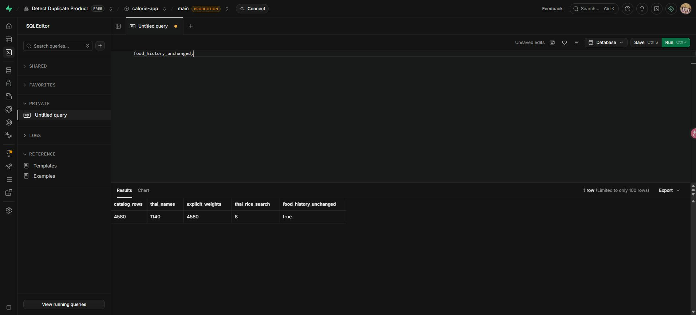

# ข้อมูลอาหารและผลตรวจ — 16 ตุลาคม 2026

รัน `supabase/migrations/20261016_verified_catalog_metadata.sql` บน Supabase `calorie-app` (`udovwhbldemhknhmftln`) main / PRODUCTION แล้ว

| รายการ | ก่อนทำ | หลังทำ |
|---|---:|---:|
| อาหารทั้งหมด | 4,580 | 4,580 |
| มีน้ำหนักต่อหน่วยอ้างอิงในช่อง portion_grams | 0 | 4,580 |
| มีชื่อภาษาไทยในช่อง name_th | 0 | 1,140 |
| ชื่อที่ยังต้องตรวจคำแปล | 4,580 | 3,440 |

## แหล่งข้อมูลและขอบเขตการตรวจ

- ใช้ `supabase/fndds_foods_curated.csv` ซึ่งเป็นสำเนาข้อมูล USDA FNDDS 2021–2023 ที่มีอยู่ในโปรเจกต์ ขนาดบริโภคและกรัมระบุอยู่ในชื่ออาหารเดิมทุกแถว
- เปรียบเทียบ food_code ชื่ออังกฤษ หมวดหมู่ และสารอาหารทั้งหกช่องกับแค็ตตาล็อกที่อ่านจากฐานจริงก่อนแก้ไข พบว่าตรงกันทั้ง 4,580 รายการ
- แยกวงเล็บขนาดบริโภคแบบตรวจวงเล็บซ้อน เพื่อไม่หยิบรายละเอียดขนาดหรือเปอร์เซ็นต์ไขมันผิดตำแหน่ง
- ไม่ได้ดาวน์โหลดตาราง USDA ต้นทางเพื่อเทียบอาหารและสารอาหารรายแถวซ้ำในรอบนี้ เนื่องจากเครื่องเชื่อมต่อเว็บไซต์ดาวน์โหลดไม่ได้ จึงไม่ถือว่าผลครั้งนี้เป็นการรับรองความถูกต้องของข้อมูลโภชนาการต้นฉบับโดยอิสระ
- ตรวจเอกสารอธิบายชุดข้อมูลจาก [USDA FNDDS Downloads](https://www.ars.usda.gov/northeast-area/beltsville-md-bhnrc/beltsville-human-nutrition-research-center/food-surveys-research-group/docs/fndds-download-databases) และ [FNDDS 2021–2023 Documentation](https://www.ars.usda.gov/ARSUserFiles/80400530/pdf/fndds/2021_2023_FNDDS_Doc.pdf) ไว้เป็นแหล่งอ้างอิงสำหรับตรวจต่อ

## ความหมายของหน่วย

หนึ่งหน่วยอ้างอิงหมายถึงขนาดทั้งหมดที่ระบุในชื่อเดิม ไม่เปลี่ยนฐานสารอาหาร เช่น นมเต็มมันเนย 1 cup = 244 g ใช้ `serving_size=1`, `serving_unit=portion`, `portion_grams=244` และป้าย `ถ้วยตวง (244 กรัม)` นม 122 กรัมจึงเท่ากับ 0.5 หน่วย และได้พลังงาน 74.4 kcal จากข้อมูลเดิม 148.8 kcal ต่อหน่วย

ขนาดเดิมที่เป็นครึ่งตัวหรือชุดสิบชิ้นยังเป็นหนึ่งหน่วยอ้างอิงของชุดนั้น เช่น เป็ดครึ่งตัว 380 กรัม หรือมันฝรั่งแท่งสิบแท่ง 3 กรัม ไม่หารซ้ำตามจำนวนชิ้น สำหรับคำอธิบายหน่วยที่ยังไม่มีคำแปลเฉพาะ ใช้ป้าย `หน่วยอ้างอิงตามต้นฉบับ (… กรัม)` พร้อมเก็บคำอธิบายอังกฤษไว้ในข้อมูลตรวจทาน ไม่สมมติให้เป็นจาน/ชามไทย และไม่แปลงกรัมเป็นมิลลิลิตร

## ชื่อภาษาไทย

ใช้พจนานุกรมคำแปลที่ตรวจทานใน `supabase/data/food-thai-glossary.json` และปรับคำตามบริบทของนม ไข่ และข้าว แปลเฉพาะรายการที่มีคำแปลครบทุกส่วนของคำอธิบาย เพื่อรักษาชนิดอาหาร วิธีปรุง หนัง/เปลือกที่กิน และส่วนผสมตามต้นฉบับ ไม่แทนอาหารต่างประเทศด้วยเมนูไทยที่สูตรต่างกัน

รายการที่ยังแปลไม่ครบเก็บ `name_th=null` ให้แอปแสดงชื่ออังกฤษตามเดิม ดู `supabase/data/catalog-thai-pending.json` (3,440 รายการ พร้อมวลีที่ยังต้องตรวจ) อาหารที่มีชื่อไทยเดิมจากผู้ใช้จะไม่ถูกเขียนทับเมื่อรันซ้ำ

## หลักฐานบนฐานจริง

- SQL Editor คืนจำนวนอัปเดต 4,580 รายการ ชื่อไทย 1,140 รายการ และน้ำหนัก 4,580 รายการ
- อ่านแค็ตตาล็อกครบทุกแถวผ่าน REST API หลัง commit และตรวจเทียบ ID ชื่ออังกฤษ หมวดหมู่ และโภชนาการกับสำเนาก่อนแก้ไข ทั้งหมดไม่เปลี่ยน
- ตรวจหน่วยและชื่อไทยทุกแถวตรงกับชุดข้อมูลที่เตรียมไว้
- RPC ค้น `ข้าว` / `นม` / `ไข่` ได้อย่างละ 8 รายการ และ `กล้วย` 2 รายการ พร้อมกรองหมวดถูกต้อง
- จำนวนประวัติอาหารยังเป็น 6 รายการ และ checksum ทั้งแถวก่อน/หลังตรงกัน (`29c07d099f4ac24342f45030eef1a046`) ไม่มีการคำนวณย้อนหลัง
- ชุดทดสอบ `npm.cmd test` ใน `database-tests` ผ่าน รวม fresh/upgrade, รันซ้ำ, RLS, ปฏิเสธต้นฉบับที่เปลี่ยน, ปฏิเสธหน่วยที่มีการแก้เอง, ค้นไทย, แปลงกรัม และรักษาประวัติ/โภชนาการเดิม



ผลตรวจ API แบบอ่านอย่างเดียวอยู่ใน `docs/catalog-verification-2026-10-16.json` ยังไม่ได้ทดสอบการใช้งานผ่านหน้าแอปหรือ flow สองบัญชีจริงในรอบนี้

## ตรวจซ้ำและทำต่อ

สำรองแค็ตตาล็อกก่อนแก้ใน `supabase/data/catalog-before-2026-10-16.json` (เฉพาะ catalog ไม่มีข้อมูลบัญชีหรือประวัติสุขภาพ) ชุดข้อมูลที่เพิ่ม metadata อยู่ใน `supabase/data/catalog-metadata-reviewed.json`

สร้างไฟล์ migration ใหม่หลังเพิ่มคำแปลที่ตรวจแล้วด้วย:

```powershell
./.venv/Scripts/python.exe backend/scripts/build_catalog_metadata.py
```

ทดสอบ migration ก่อนนำไปใช้ และตรวจผล API หลังรันด้วย:

```powershell
Set-Location database-tests
npm.cmd test
Set-Location ..
./.venv/Scripts/python.exe backend/scripts/verify_catalog_metadata.py --report docs/catalog-verification-2026-10-16.json
```

Migration ตรวจข้อมูลต้นทางและหน่วยที่มีอยู่ก่อนอัปเดตทั้งหมด หากไม่ตรงกันจะยกเลิกทั้ง transaction จึงควรตรวจสาเหตุแทนการลบเงื่อนไขตรวจ รันหลังนำเข้า CSV ต้นฉบับและ migration เดิมสำหรับ project ใหม่ ไม่รันบน catalog ที่ใช้แหล่งข้อมูลคนละชุด
