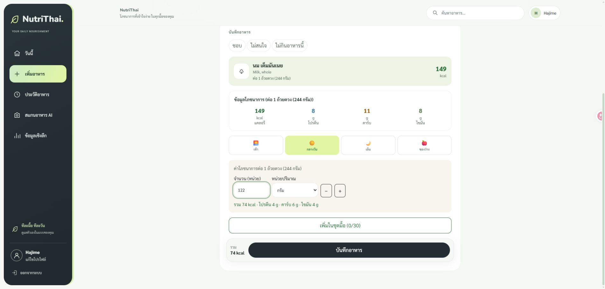

# ชื่ออาหารและการแสดงตัวเลข — 17 ตุลาคม 2026

รัน `supabase/migrations/20261017_separate_food_names.sql` บน Supabase `calorie-app` แล้ว แยกครบ 4,580 รายการ

| ฟิลด์ | ตัวอย่าง |
|---|---|
| `name` / `english_name` | `Milk, whole` |
| `source_portion` (ใหม่) | `1 cup, 244 g` |
| `original_name` (ใหม่) | `Milk, whole (1 cup, 244 g)` |

แยกเฉพาะวงเล็บท้ายที่ระบุหน่วยและกรัมอย่างชัดเจน คงชื่อประเภทอาหาร เช่น `Milk, reduced fat (2%)` และจัดการหน่วยที่มีวงเล็บซ้อน เช่น `1 meal (16.5 oz), 468 g` ได้ ชื่อไทยเดิมยังอยู่ครบ

## ความละเอียดและประวัติ

ID, food_code, สารอาหารทุกค่า, serving_size, serving_unit, serving_label และ portion_grams ไม่เปลี่ยน มีสำเนาก่อนแก้ที่ `.local-run/catalog-name-before-2026-10-17.json` ซึ่งไม่รวมใน Git

Migration ตรวจ hash ของค่าที่ไม่ควรเปลี่ยนและ food_logs ก่อน/หลังภายใน transaction และจะยกเลิกทั้งชุดหากไม่ตรง ไม่แก้ประวัติย้อนหลัง ไม่เปลี่ยน RLS ของตารางจริง

หน้าเว็บปัดตัวเลขผลลัพธ์เป็นจำนวนเต็ม เช่น `148.8 → 149`, `8.2 → 8`, `28.35 กรัม → 28 กรัม` โดยใช้ `displayInteger` และ `displayMeasurements` ค่าดิบใน API/ฐานข้อมูลและช่องกรอกยังละเอียดเท่าเดิม คำนวณและรวมค่าก่อนปัดผลลัพธ์ ชื่อใน snapshot เก่าที่มีหน่วยท้ายถูกแยกตอนอ่านมาแสดง โดยไม่เขียนทับประวัติ

## ผลตรวจ

- ตรวจผ่าน REST API ครบ 4,580 แถว เทียบกับสำเนาก่อนแก้ ค่าเดิมที่ไม่ใช่ชื่อทุกฟิลด์ตรงกัน
- ค้นหาไทย (`นม`, `ข้าว`) และอังกฤษ (`Milk`) ผ่าน search_foods ได้ พร้อมฟิลด์ใหม่
- รายงาน: [catalog-name-verification-2026-10-17.json](catalog-name-verification-2026-10-17.json)
- Frontend 85 tests / 14 ไฟล์, TypeScript และ production build ผ่าน
- Database fresh/upgrade, RLS สองบัญชี, การรัน migration ซ้ำ, แยกวงเล็บซ้อน, ความแม่นยำสารอาหาร และประวัติเดิมผ่าน
- ตรวจเว็บจริง: ค้นหา Milk แล้วชื่อไม่มีหน่วยปนอยู่ นมเต็มมันเนย 148.8 kcal แสดง 149 kcal เลือก 122 กรัมคำนวณจากค่าดิบได้ 74.4 kcal และแสดง 74 kcal ไม่บันทึกรายการทดลอง

ตรวจฐานจริงซ้ำด้วย `backend/scripts/verify_catalog_names.py --before .local-run/catalog-name-before-2026-10-17.json --report docs/catalog-name-verification-2026-10-17.json` ผ่าน Python ใน `.venv`
