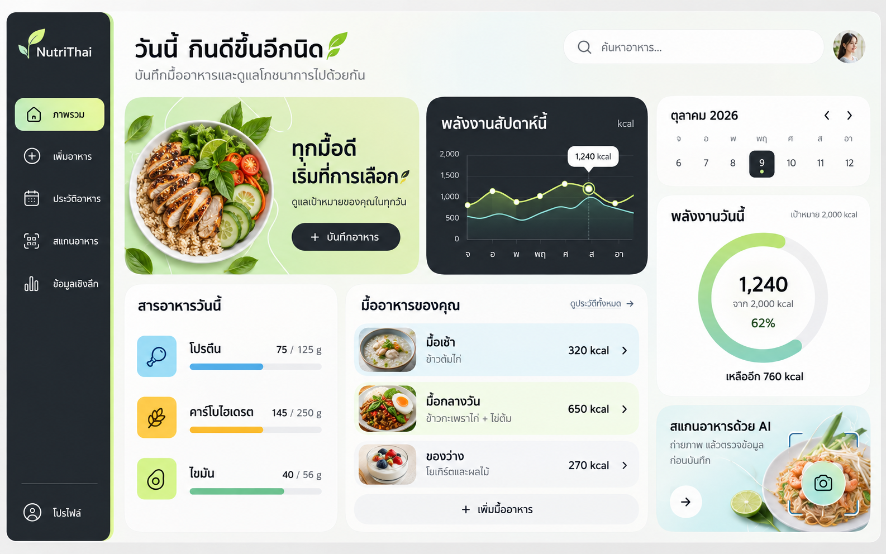

# แนวทางออกแบบ Frontend ของ NutriThai

ปรับ [หน้าที่เหลือเป็น Soft Green ครบแล้ว](soft-green-all-pages-2026-10-16.md): ประวัติ ข้อมูลเชิงลึก สแกน AI ฟอร์มย่อย เข้าสู่ระบบ สมัครสมาชิก และกู้รหัสผ่าน

ปรับ [หน้าโปรไฟล์และเมนูผู้ใช้](soft-green-profile-2026-10-16.md) เป็น Soft Green แล้ว พร้อมการแก้ไขในหน้าเดียวและสรุปเป้าหมาย

นำสไตล์ไปใช้กับ [หน้าเพิ่มอาหารแล้ว](soft-green-add-food-2026-10-16.md) ตามคำสั่งเพิ่มเติม หน้าอื่นรอผู้ใช้สั่งต่อ

ผู้ใช้ให้เก็บภาพนี้เป็นคอนเซปต์เมื่อ 9 ตุลาคม 2026 และอนุมัติให้ปรับหน้าเว็บพร้อมรองรับมือถือเมื่อ 16 ตุลาคม 2026 พัฒนาแล้ว ดู [รายละเอียดการนำไปใช้และผลตรวจ](soft-green-implementation-2026-10-16.md)

## แนวทางภาพ

- พื้นหลังขาวนวล โทนเขียวมิ้นต์–ไลม์ และสีฟ้าอ่อน
- แถบเมนูด้านซ้ายสีเข้ม พร้อมสถานะเมนูที่เลือกสีเขียวอ่อน
- การ์ดมุมโค้ง ระยะห่างโปร่ง และตัวอักษรภาษาไทยอ่านง่าย
- Dashboard แสดงพลังงาน สารอาหาร มื้ออาหาร กราฟรายสัปดาห์ และทางเข้าสแกนอาหารด้วย AI
- ใช้ภาพอาหารประกอบเพื่อสร้างบรรยากาศและช่วยแยกรายการ

## ขอบเขตการนำไปใช้

นำแนวทางไปใช้กับ Dashboard และโครงหน้าเว็บแล้ว พร้อมเมนูด้านล่างบนมือถือ หน้าเว็บจริงใช้ข้อมูลจากโปรไฟล์และรายการอาหารของผู้ใช้ ส่วนตัวเลข อาหาร กราฟ และวันที่ในภาพคอนเซปต์และ Figma เป็นข้อมูลตัวอย่าง

## ที่มา

สร้างด้วยเครื่องมือ ImageGen แบบ built-in โดยอ้างอิงภาพ dashboard ที่ผู้ใช้แนบในบทสนทนา คงไฟล์ต้นฉบับที่สร้างไว้และคัดลอกภาพมาเก็บในโปรเจกต์

สรุป prompt ที่ใช้: สร้างภาพ UI mockup ของ NutriThai แบบ desktop โดยอ้างอิงพื้นขาวนวล แถบเมนู charcoal การ์ดโค้งขนาดใหญ่ โทน mint/lime/aqua และระยะห่างโปร่งจากภาพต้นแบบ ปรับข้อความเป็นภาษาไทย พร้อมฟีเจอร์บันทึกอาหาร สรุปโภชนาการ กราฟรายสัปดาห์ และสแกนอาหาร AI
