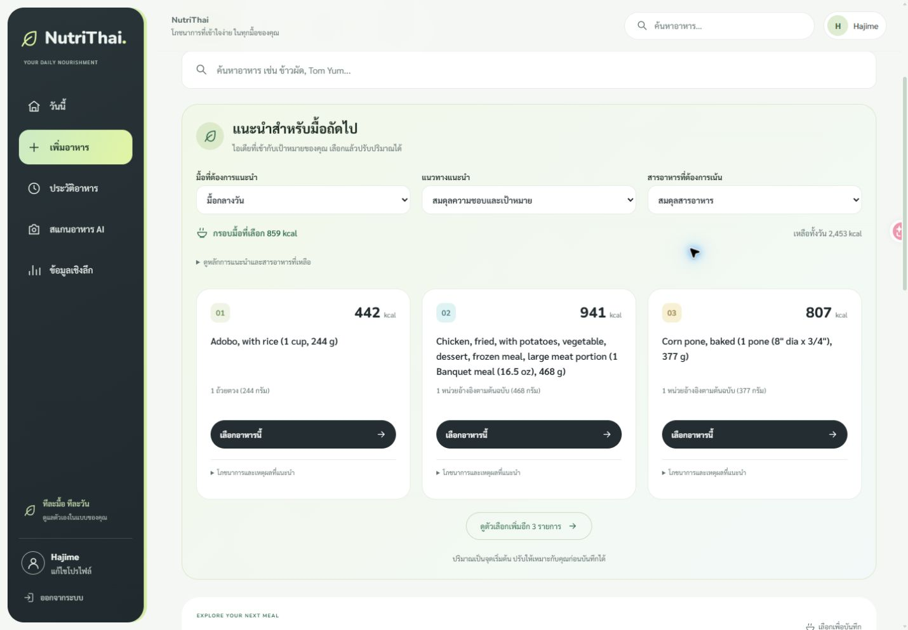
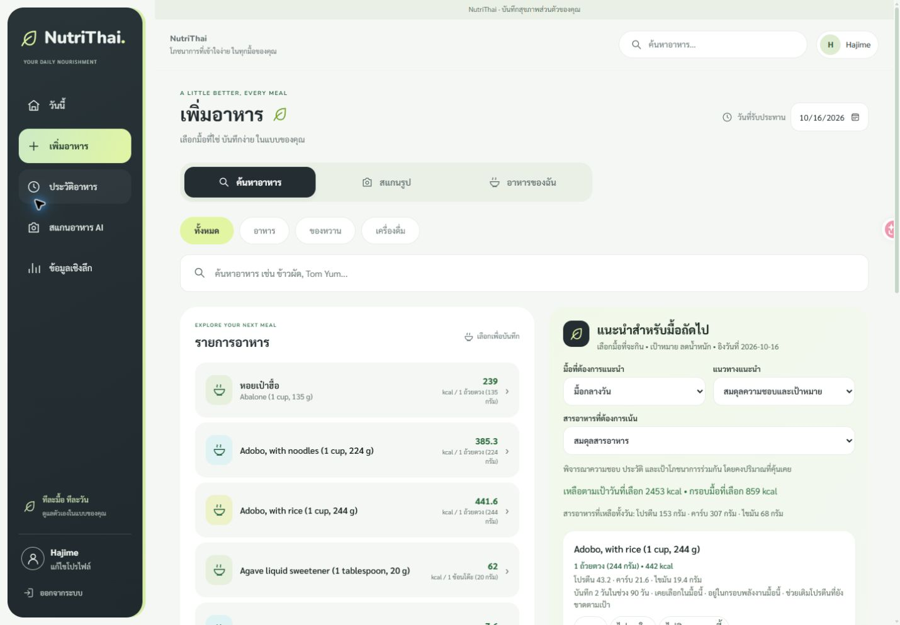
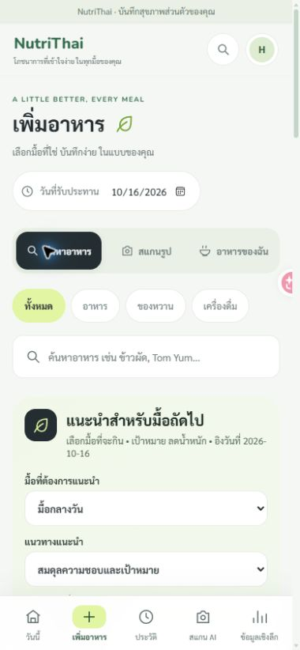

# หน้าเพิ่มอาหาร — Soft Green

## ปรับโซนคำแนะนำรอบเพิ่มเติม

ขยาย “แนะนำสำหรับมื้อถัดไป” ให้เต็มความกว้างแทนคอลัมน์ด้านข้าง จัดตัวเลือกเป็นแถวเดียวบน desktop และการ์ดอาหารสามคอลัมน์ แสดงก่อน 3 รายการพร้อมปุ่มดูเพิ่มเติม ย้ายหลักการแนะนำ สารอาหาร เหตุผล และปุ่มความชอบไว้ในรายละเอียดที่เปิดดูได้ Mobile เรียงคอลัมน์เดียว คงสูตรและปริมาณแนะนำเดิม

ตรวจ frontend 79 tests, TypeScript และ production build ผ่าน ลองปุ่มดูเพิ่ม/แสดงน้อยลงและเปิดรายละเอียดในเบราว์เซอร์แล้ว

ภาพและคำอธิบายด้านล่างเป็นการออกแบบรอบแรกก่อนปรับโซนคำแนะนำ

ปรับเฉพาะหน้าเพิ่มอาหารตามคำขอ ใช้สี ฟอนต์ การ์ดโค้ง ไอคอน และปุ่มสี charcoal ให้สอดคล้องกับ Dashboard หน้าอื่นรอคำสั่งเพิ่มเติม

- หัวหน้าและวันที่รับประทาน แท็บค้นหา/สแกน/อาหารของฉัน และหมวดอาหารมีสถานะที่เลือกชัดเจน
- Desktop วางรายการอาหารและคำแนะนำเป็นสองคอลัมน์ Mobile เรียงคำแนะนำและรายการอาหารใต้ช่องค้นหา
- คำแนะนำใช้พื้นเขียวอ่อน รายการอาหารใช้การ์ดขาวและไอคอนโทน mint/aqua/lime
- ไม่แสดงชื่ออังกฤษซ้ำเมื่อชื่อไทยยังเป็นข้อความเดียวกัน และยอมให้ชื่อยาวขึ้นบรรทัดใหม่ในรายการค้นหา
- ฟอร์มอาหารส่วนตัว แผงเลือกปริมาณ และปุ่มบันทึกใช้รูปแบบเดียวกัน
- CSS อยู่ใน `frontend/src/food-logger.css` และจำกัดด้วย `.food-logger` เพื่อไม่เปลี่ยนหน้า AI แบบแยก ประวัติ หรือ Insights
- คง API สูตรแนะนำ หน่วยบริโภค การคำนวณ ชุดมื้อ และการยินยอมส่งภาพเดิม

## ผลตรวจ

Frontend 79 tests ใน 13 ไฟล์, TypeScript และ production build ผ่าน ตรวจขนาด 320/390/768/1440px ไม่พบ body ล้นแนวนอน ลองค้นหาภาษาไทย เลือกรายการ เปิดแผงปริมาณ และฟอร์มอาหารส่วนตัว โดยไม่บันทึกข้อมูลทดสอบลงบัญชีจริง

