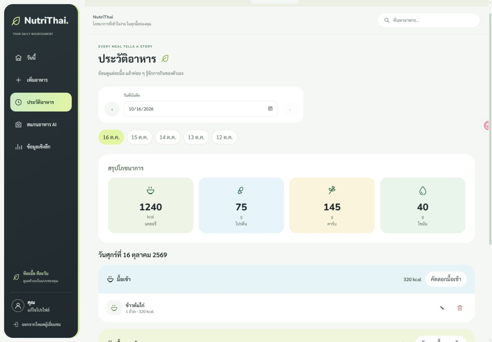
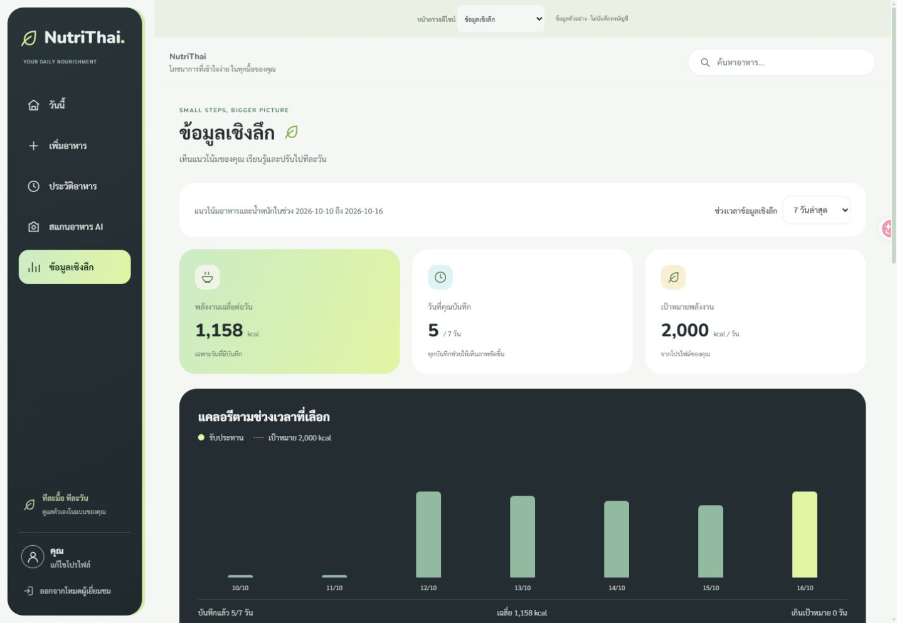
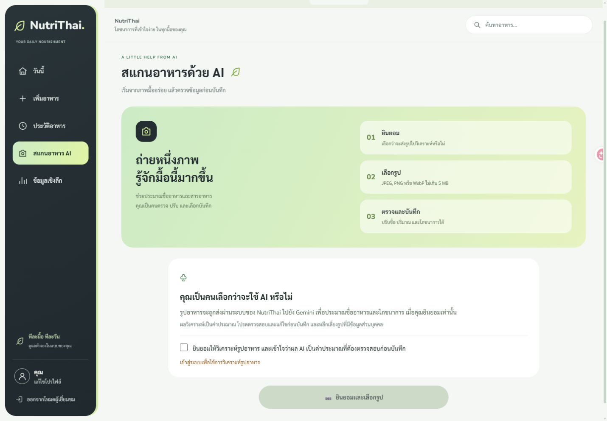
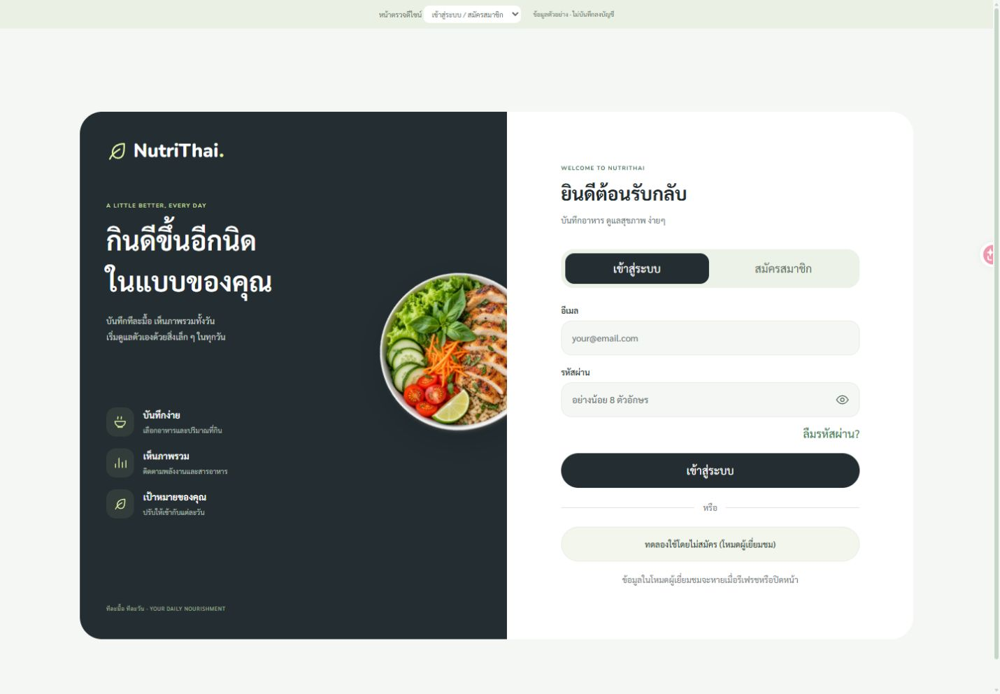

# Soft Green — หน้าที่เหลือ

ปรับหน้าที่เหลือให้ใช้สี รูปแบบการ์ด ฟอนต์ ไอคอน ช่องกรอก และปุ่มร่วมกับ Dashboard หน้าเพิ่มอาหาร และโปรไฟล์

- **ประวัติอาหาร:** หัวหน้าใหม่ ตัวเลือกวัน การ์ดพลังงาน/สารอาหารสี pastel มื้ออาหารแยกสี ไอคอนลบที่ตรงความหมาย และหน้าข้อมูลว่าง
- **ฟอร์มในประวัติ:** แก้ไขบันทึก เปลี่ยนอาหาร และคัดลอกมื้อ ใช้ช่องกรอกและปุ่มรูปแบบเดียวกัน
- **ข้อมูลเชิงลึก:** การ์ดค่าเฉลี่ย/จำนวนวัน/เป้าหมาย กราฟบนพื้น charcoal ตัวเลือกช่วงเวลา ข้อสังเกต และบันทึกน้ำหนัก
- **สแกน AI:** แนะนำขั้นตอนบนการ์ด mint/lime การยินยอมและเลือกภาพ ผลวิเคราะห์ การแก้ผลเป็นภาษาไทย และแผงบันทึก
- **เข้าสู่ระบบ/สมัครสมาชิก:** แบ่งพื้นที่แนะนำแอปสี charcoal กับฟอร์มสีขาว ใช้ภาพอาหารเดิมเป็นภาพตกแต่ง
- **ลืมรหัสผ่าน/ตั้งรหัสผ่านใหม่:** ใช้ AuthLayout ร่วมกัน รวมข้อความแจ้งสำเร็จและข้อผิดพลาดเดิม
- **ระหว่างโหลด/ข้อผิดพลาดบัญชี:** ใช้สี ไอคอน และปุ่มรูปแบบใหม่

ใช้ `PageHeading.tsx` และ `AuthLayout.tsx` ร่วมกัน โดยเก็บสไตล์ใน `remaining-pages.css` ไม่มีการแก้ฐานข้อมูล สูตรคำนวณ หรือวิธีเรียก API

## ผลตรวจ

Frontend **81 tests / 13 ไฟล์**, TypeScript และ production build ผ่าน ตรวจหน้าหลักที่ปรับบน 320px และ 768px ไม่มี body ล้นแนวนอน ตรวจภาพ desktop 1440px และ mobile 390px เพิ่มเติม ฟอร์มแก้ไขบันทึก คัดลอกมื้อ และช่วงวันที่แบบกำหนดเองผ่านการตรวจขนาด 320px

เปิดประวัติ สแกน AI และ Insights ในบัญชีจริงแล้ว ตรวจว่าการเลือกภาพยังปิดไว้ก่อนยินยอม ไม่บันทึก/ลบรายการอาหารหรือน้ำหนัก ไม่ส่งภาพ ไม่เปลี่ยนรหัสผ่าน และไม่ส่งอีเมลระหว่างตรวจ UI ชุดทดสอบตรวจ authentication และการบันทึกผ่าน mock ตามเดิม

หน้าตรวจดีไซน์ `frontend/design-preview.html` ใช้ข้อมูลสังเคราะห์ มีตัวเลือกหน้าสำหรับตรวจ UI และป้องกัน submit ของฟอร์ม authentication ไม่อยู่ใน production entry

## ภาพ

