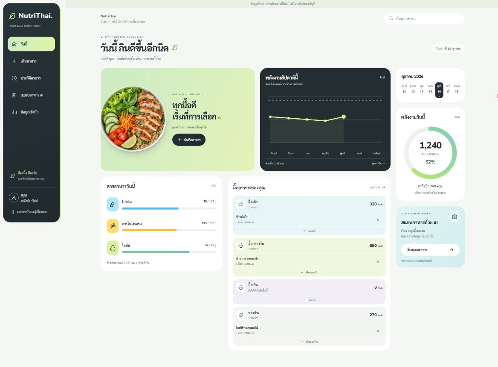

# Soft Green Dashboard — 16 ตุลาคม 2026

ปรับ Dashboard และโครงหน้าเว็บตามคำขอ พร้อมรองรับมือถือ ใช้พื้นขาวนวล สี mint/lime/aqua การ์ดโค้ง และแถบเมนู charcoal

- Desktop: sidebar ตั้งแต่ 1024px, จัดกลุ่ม hero/กราฟ สารอาหาร/มื้ออาหาร และคอลัมน์พลังงาน
- Tablet: ลดจำนวนคอลัมน์ตามพื้นที่ เมนูด้านล่างเมื่อเล็กกว่า 1024px
- Mobile: เรียง hero → พลังงาน → สารอาหาร → มื้ออาหาร → กราฟ → ปฏิทิน → AI; ปุ่มเมนูสูงอย่างน้อย 59px และรองรับ safe area
- กราฟ วงแหวน สารอาหาร และมื้ออาหารคำนวณจากข้อมูลจริง ไม่วาดข้อมูลของวันในอนาคต
- คงการค้นหา เพิ่ม/ลบอาหาร เปิดประวัติ โปรไฟล์ ระบบแนะนำอาหาร และทางเข้าสแกน AI

## Figma และภาพตรวจ

[ไฟล์ Figma](https://www.figma.com/design/2ks2VrGZK9YesLMa0Etwmr) มี [Desktop 1440px](https://www.figma.com/design/2ks2VrGZK9YesLMa0Etwmr?node-id=4-161) และ [Mobile 390px](https://www.figma.com/design/2ks2VrGZK9YesLMa0Etwmr?node-id=4-260) เป็นเลเยอร์แก้ไขได้ พร้อมตัวแปรสีและ MacroRow component ใช้ภาพ raster เฉพาะรูปอาหาร

ภาพ Figma: [Desktop](soft-green-figma-desktop.png), [Mobile](soft-green-figma-mobile.png)

`build-soft-green.figma.js` เป็นสคริปต์สร้างโครงเริ่มต้น ไม่ใช่สคริปต์ sync และการรันซ้ำจะสร้างเลเยอร์ซ้ำ มีการปรับระยะข้อความ ปุ่ม วงแหวน และสีเพิ่มเติมในไฟล์ Figma หลังสร้าง

## ผลตรวจ

- Frontend: 79 tests ใน 13 ไฟล์ผ่าน
- TypeScript `tsc --noEmit` และ `npm.cmd run build` ผ่าน
- ตรวจ Dashboard บน desktop 1440px, tablet 768px และ mobile 390px
- ตรวจหน้าเพิ่มอาหาร ประวัติ AI และ Insights ที่ 320px ไม่มี body ล้นแนวนอน
- ตรวจการเปลี่ยนเมนูและสถานะข้อมูลว่าง ไม่สร้างหรือลบข้อมูลบัญชีระหว่างตรวจหน้าตา
- รัน local ที่ http://localhost:3000 โดย backend อยู่ http://127.0.0.1:8000

`frontend/design-preview.html` และ `src/design-preview.tsx` เป็นหน้าตรวจดีไซน์ที่ใช้ข้อมูลสังเคราะห์ ไม่เรียก API หรือบันทึกข้อมูลบัญชี และไม่เป็น production entry ภาพที่ส่งเข้า Figma มาจากหน้านี้

## ที่มาภาพอาหาร

สร้างด้วย ImageGen แบบ built-in เก็บไว้ที่ `frontend/public/images/nutrithai-bowl.png` เป็น PNG โปร่งใส 1280×1280 ใช้เป็นภาพตกแต่ง ไม่ใช่ผลวิเคราะห์อาหารของผู้ใช้

สรุป prompt: ภาพถ่ายมุมบนของชามขาวใส่ไก่ย่าง ข้าวกล้อง ผักสลัด โหระพา แตงกวา มะเขือเทศ แครอต และมะนาว แสงธรรมชาตินุ่ม แยกวัตถุบนพื้นโปร่งใส ไม่มีข้อความหรือ UI
