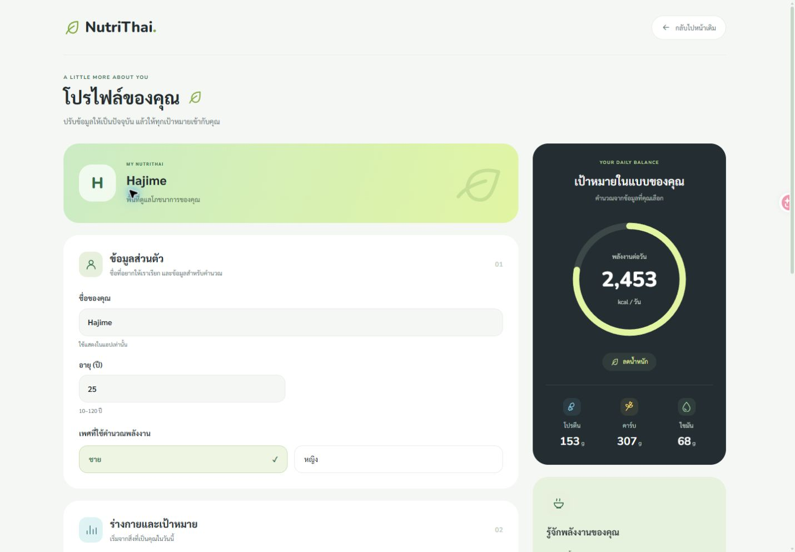

# โปรไฟล์ผู้ใช้ — Soft Green

ออกแบบหน้าโปรไฟล์และเมนูผู้ใช้ใหม่ให้เข้ากับ Dashboard ใช้การ์ด mint/lime พื้นขาวนวล สรุปสี charcoal ไอคอนสารอาหารสีฟ้า/เหลือง/เขียว และปุ่มทรง pill

- การแก้ไขโปรไฟล์เห็นข้อมูลส่วนตัว ร่างกาย เป้าหมาย และกิจกรรมทั้งหมดในหน้าเดียว
- การเริ่มใช้งานครั้งแรกคง 3 ขั้นตอน พร้อมแถบขั้นตอนในรูปแบบใหม่
- คำนวณพลังงาน สารอาหาร BMR และ TDEE จากค่าที่กรอกด้วยสูตรเดิม มีสรุปด้านข้างบน desktop
- Mobile เรียงสรุปไว้หลังฟอร์มและก่อนปุ่มบันทึก
- กลับไปหน้าเดิมโดยไม่บันทึกได้ ปิดการแก้ไขและปุ่มกลับระหว่างบันทึก
- เมนูผู้ใช้แสดงชื่อ สถานะบัญชี ทางแก้ไขโปรไฟล์ และออกจากระบบ
- ชื่อแสดงผลยังใช้ local storage ตามเดิม ข้อมูลสุขภาพบันทึกผ่าน handler/API เดิม ไม่มีการเปลี่ยน schema

## ผลตรวจ

Frontend 81 tests ผ่าน รวมการตั้งค่า 3 ขั้นตอน การแก้ไขทั้งหมดพร้อมคำนวณใหม่ และการกลับโดยไม่บันทึก; TypeScript และ production build ผ่าน ตรวจความกว้าง 320/390/768/1440px ไม่มี body ล้นแนวนอน ลองแก้น้ำหนักชั่วคราวแล้วกลับโดยไม่บันทึก ยืนยันว่าเปิดมาใหม่ยังเป็นข้อมูลเดิม ไม่บันทึกข้อมูลทดสอบลงบัญชี

