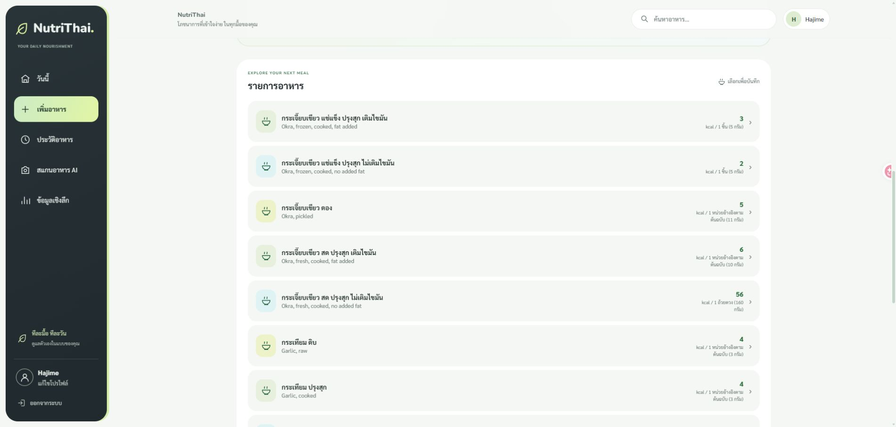

# แสดงชื่ออาหารภาษาไทยก่อน — 17 ตุลาคม 2026

ปรับครบทั้งรายการอาหาร ผลค้นหา และคำแนะนำ ให้รายการที่มีชื่อภาษาไทยขึ้นก่อน รายการที่ยังไม่มีคำแปลยังค้นหาและเลือกได้

- Supabase เพิ่ม `has_thai_name` เป็น generated column ตรวจอักษรไทยใน `name_th` อัตโนมัติ จึงไม่ถือว่าชื่ออังกฤษที่คัดลอกไว้ในช่องนี้เป็นชื่อไทย
- จัดลำดับใน `search_foods` ก่อน LIMIT และใน backend ก่อนแบ่งหน้ารายการ ใช้ชื่อและ ID เป็นลำดับคงที่
- Frontend แบ่งกลุ่มภาษาไทยก่อนโดยรักษาลำดับเดิมภายในกลุ่ม
- คำแนะนำยังกรองความถูกต้องของสารอาหาร หน่วยบริโภค กรอบมื้อ และอาหารที่ซ่อนก่อน ให้ภาษาไทยมาก่อนภายในกลุ่มที่ผ่านเงื่อนไข แล้วใช้คะแนนความชอบ/เป้าหมายและความหลากหลายเดิม
- ไม่แปลชื่อใหม่ ไม่ซ่อนชื่ออังกฤษ และไม่แก้โภชนาการหรือประวัติ

รัน `20261017_thai_first_foods.sql` บน Supabase `calorie-app` แล้ว มีชื่อไทย 1,140 จาก 4,580 รายการ ส่วนอีก 3,440 รายการเป็น fallback

## ผลตรวจ

- Frontend 89 tests, backend 64 tests, TypeScript และ production build ผ่าน
- Database fresh/upgrade, RLS, การรันซ้ำ, การจัดภาษาไทยก่อน LIMIT, การกรองหมวด และการค้นหาสัญลักษณ์ผ่าน
- API จริง: browse limit 5 ได้ชื่อไทยทั้งหมด; ค้น Milk limit 8 ได้ชื่อไทยทั้งหมด; ค้น Agave ที่ยังไม่มีคำแปลยังพบ
- ดึงรายการครบ 4,580 แถวหลังแบ่งหน้า ไม่มี ID หายหรือซ้ำ และรายการชื่อไทยทั้งหมดอยู่ก่อน fallback
- [รายงานผล](thai-first-verification-2026-10-17.json)

