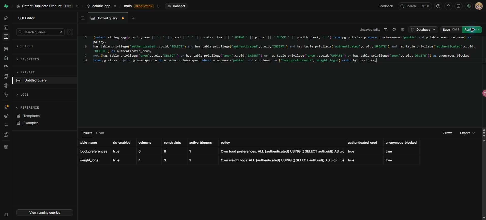

# ผลตรวจ migration ความชอบอาหารและน้ำหนัก — 16 ตุลาคม 2026

รันไฟล์ `supabase/migrations/20261009_preferences_weights.sql` ผ่าน SQL Editor บน Supabase `calorie-app` (`udovwhbldemhknhmftln`) สาขา main / PRODUCTION ซึ่งตรงกับ `SUPABASE_URL` ใน `.env`

ก่อนรันพบตาราง `foods`, `custom_foods`, `food_preferences`, `weight_logs` และฟังก์ชัน `set_updated_at()` อยู่แล้ว จึงรัน migration แบบรันซ้ำได้ตามไฟล์ปัจจุบัน SQL Editor แสดง `Success. No rows returned` หลัง commit พร้อมแจ้ง PostgREST reload schema

## ผลตรวจหลังรันบนฐานจริง

| ตาราง | คอลัมน์ | Constraints | Trigger ที่เปิดใช้ | RLS | สิทธิ์ authenticated | สิทธิ์ anon |
|---|---:|---:|---:|---|---|---|
| food_preferences | 6 | 6 | 1 | เปิด | SELECT/INSERT/UPDATE/DELETE | ไม่มีทั้งสี่สิทธิ์ |
| weight_logs | 4 | 3 | 1 | เปิด | SELECT/INSERT/UPDATE/DELETE | ไม่มีทั้งสี่สิทธิ์ |

- `Own food preferences`: ใช้กับ authenticated ทุกคำสั่ง จำกัด user_id ให้ตรง auth.uid() ทั้ง USING และ WITH CHECK พร้อมตรวจว่า custom_food_id เป็นของผู้ใช้เดียวกัน
- `Own weight logs`: ใช้กับ authenticated ทุกคำสั่ง จำกัด user_id ให้ตรง auth.uid() ทั้ง USING และ WITH CHECK
- Migration ไม่แก้ข้อมูล food catalog และไม่ได้เพิ่มบันทึกสุขภาพสำหรับการตรวจครั้งนี้

## ผลตรวจในเครื่องและงานที่ยังรอ

`npm.cmd test` ใน `database-tests` ผ่านทั้ง fresh install และ upgrade รวมการรัน migration ซ้ำ การเขียน/แก้ไขความชอบและน้ำหนัก การแยกสิทธิ์สองตัวตน และการปฏิเสธ anonymous

การตรวจบน Supabase ครั้งนี้ยืนยัน schema และการตั้งค่าสิทธิ์ ยังไม่ได้ทดสอบ flow ผ่านแอปหรืออ่าน/เขียนข้ามสองบัญชีจริง และไม่ได้ deploy frontend/backend
